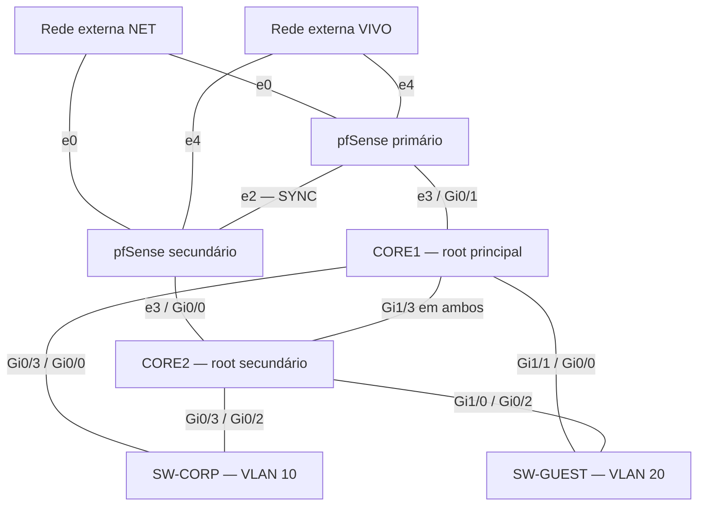

# Laboratório de alta disponibilidade com pfSense e switches Cisco

Laboratório no **EVE-NG** com dois pfSense, dois switches core e switches de acesso para as redes CORP e GUEST. O projeto documenta a configuração, os erros encontrados durante a implementação e as evidências dos testes realizados em novembro de 2026.

**Resultado comprovado:** entrega de DHCP nas VLANs 10 e 20, eleição do CORE1 como root e recuperação do acesso ao gateway da GUEST após desativar seu uplink para o CORE1.

> O teste de falha de um uplink foi concluído. A queda completa de um core, o failover completo dos firewalls, a contingência dos provedores e o resultado da otimização de RSTP ainda precisam de validação.

## Objetivos

- Segmentar o laboratório em VLANs.
- Manter a Infraestrutura em alta disponibilidade.
- Utilizar VIPs CARP como gateways dos clientes.
- Manter associações de interfaces consistentes entre os pfSense.
- Coordenar o DHCP com Kea em alta disponibilidade.
- Remover a dependência de um único core para os caminhos das redes de acesso.
- Entender a eleição do root, o bloqueio de caminhos redundantes e a convergência do Rapid PVST+.
- Resolver falhas usando configuração de portas, tabela MAC, CDP, captura de pacotes e logs.

## Topologia

Nos links entre equipamentos diferentes, o primeiro identificador pertence ao equipamento de origem da linha. A VM Windows foi utilizada em testes alternados na `Gi0/1` dos switches de acesso; as evidências não demonstram dois clientes simultâneos.

[Captura da topologia](assets/evidencias/Topologia.png).

## Equipamentos

| Equipamento | Quantidade | Papel |
|---|---:|---|
| EVE-NG | 1 ambiente | Execução do laboratório |
| pfSense Community Edition | 2 | Firewall, interfaces VLAN, CARP e serviços DHCP |
| Cisco IOSv Layer 2 | 4 | Dois cores e dois switches de acesso |
| Windows Server / VM Windows | 1 cliente documentado | Testes DHCP e ping |

A versão exibida nos switches de acesso foi **IOSv L2 15.2(4.0.55)E**. A versão exata do pfSense e a versão do EVE-NG não foram coletadas. O campo de revisão do XML do pfSense não deve ser usado como versão do produto.

## Redes e gateways

| Rede | VLAN / transporte | Sub-rede | Gateway CARP | Resultado |
|---|---|---|---|---|
| CORP | VLAN 10 | `10.10.10.0/24` | `10.10.10.1` | Cliente recebeu `10.10.10.100/24` |
| GUEST | VLAN 20 | `10.20.10.0/24` | `10.20.10.1` | Cliente recebeu `10.20.10.100/24` |
| DEVICES | VLAN 30 | `10.30.10.0/24` | Não documentado | VLAN criada; sem teste de cliente registrado |
| GERENCIA | Sem tag no pai `vtnet3`; VLAN nativa 1 nos trunks do core | `172.16.12.0/24` | Não documentado | Preservada; sem teste de acesso registrado |
| SYNC | Ligação dedicada `vtnet2` | `172.16.1.0/24` | Não se aplica | Comunicação Kea HA observada |
| LAN original | `vtnet1` | `192.168.1.0/24` | `192.168.1.1` | Fora do caminho de acesso desenhado |

A segregação em VLANs está documentada. A política de isolamento entre essas redes no firewall não foi auditada neste registro; o nome GUEST, por si só, não comprova isolamento.

## Mapa final de conexões

| Origem | Destino | Transporte |
|---|---|---|
| pfSense primário `e3 / vtnet3` | CORE1 `Gi0/1` | Trunk: 1 nativa, 10, 20 e 30 |
| pfSense secundário `e3 / vtnet3` | CORE2 `Gi0/0` | Trunk: 1 nativa, 10, 20 e 30 |
| CORE1 `Gi1/3` | CORE2 `Gi1/3` | Trunk: 1 nativa, 10, 20 e 30 |
| CORE1 `Gi0/3` | SW-CORP `Gi0/0` | Trunk: VLAN 10 |
| CORE2 `Gi0/3` | SW-CORP `Gi0/2` | Trunk: VLAN 10 |
| CORE1 `Gi1/1` | SW-GUEST `Gi0/0` | Trunk: VLAN 20 |
| CORE2 `Gi1/0` | SW-GUEST `Gi0/2` | Trunk: VLAN 20 |
| SW-CORP `Gi0/1` | Cliente CORP | Access VLAN 10 |
| SW-GUEST `Gi0/1` | Cliente GUEST | Access VLAN 20 |
| pfSense primário `e2 / vtnet2` | pfSense secundário `e2 / vtnet2` | SYNC dedicada |

## Resultados

| Verificação | Estado |
|---|---|
| DHCP CORP e gateway anunciado | Confirmado |
| DHCP GUEST e gateway anunciado | Confirmado |
| CORE1 root das VLANs 10 e 20 | Confirmado |
| Uplink para CORE2 em Alternate/Blocking no estado nominal | Confirmado |
| Recuperação da GUEST pelo CORE2 após falha do uplink para CORE1 | Confirmado por STP e retorno do ping |
| Tempo exato de convergência | Não medido |
| Restauração após o último teste | Procedimento fornecido; sem nova evidência recebida |
| Aplicação e novo teste de P2p / PortFast / BPDU Guard | Confirmado |
| Queda completa de core ou firewall | Confirmado |
| Failover entre NET e VIVO | Confirmado |

## Navegação

- [Arquitetura e decisões](docs/arquitetura.md)
- [pfSense: HA, interfaces e correção do DHCP](docs/pfsense-ha.md)
- [Implementação e configurações dos switches](docs/implementacao.md)
- [Problemas encontrados e correções](docs/troubleshooting.md)
- [Plano de testes e resultados](tests/validacao.md)
- [Índice das evidências](docs/evidencias.md)
- [Configurações base consolidadas](configs/base/)
- [Otimização proposta de RSTP](configs/otimizacao-proposta/)
- [Referências oficiais](docs/referencias.md)

## Como utilizar este repositório

1. Monte os nós e os cabos de acordo com a tabela.
2. Consulte o mapeamento de interfaces do pfSense antes de sincronizar o cluster.
3. Aplique as configurações base pelo console, conferindo o hostname do equipamento.
4. Valide DHCP e STP antes de provocar falhas.
5. Execute o roteiro de testes, restaurando cada ligação após o teste.
6. Trate a otimização como uma etapa adicional, com medição antes e depois.

Os arquivos `.cfg` são **configurações mínimas reconstruídas a partir das alterações documentadas**, e não exportações completas dos equipamentos. Aplicá-los por console em um laboratório equivalente; não substituir automaticamente uma configuração de outro ambiente.

## Conteúdo para publicação

O pacote inclui documentação, comandos e capturas selecionadas. O backup XML completo do pfSense, chaves, certificados e credenciais não fazem parte do repositório público. Nenhuma imagem de sistema operacional é distribuída.
