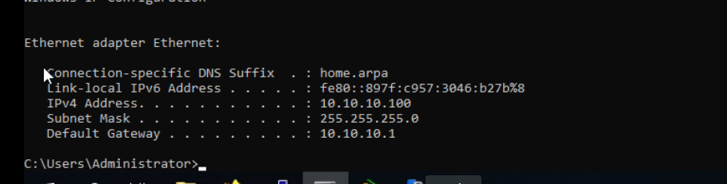
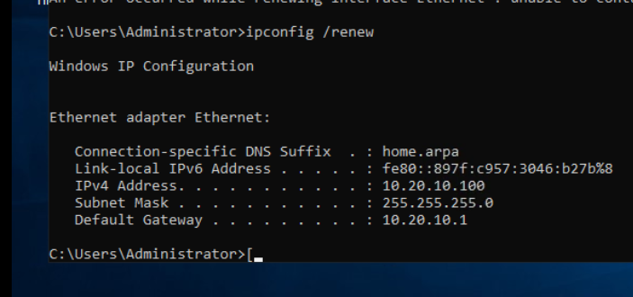
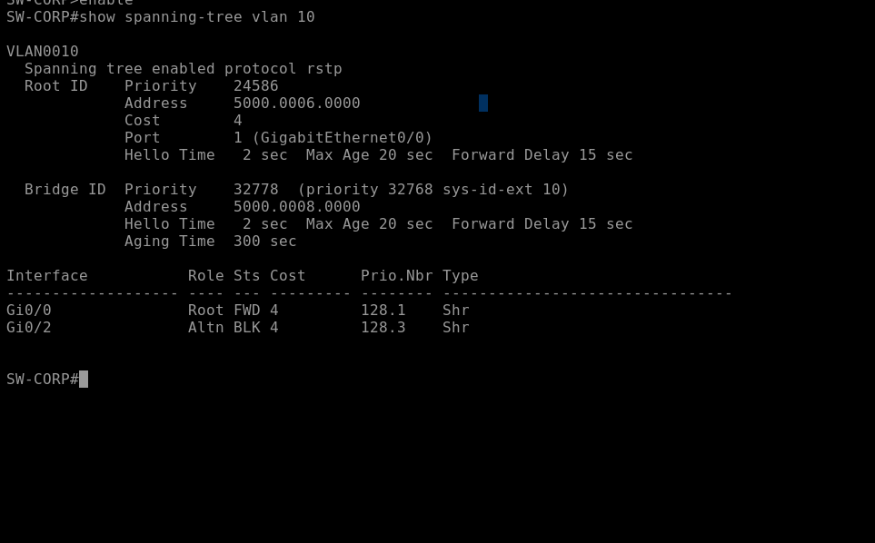
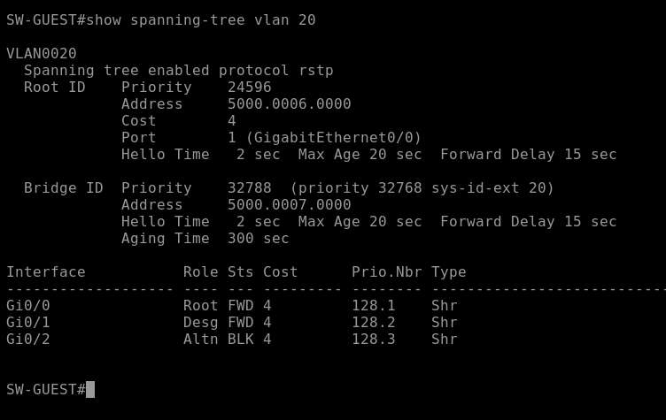
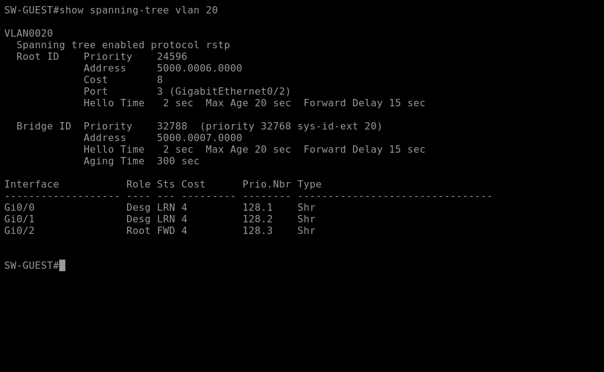
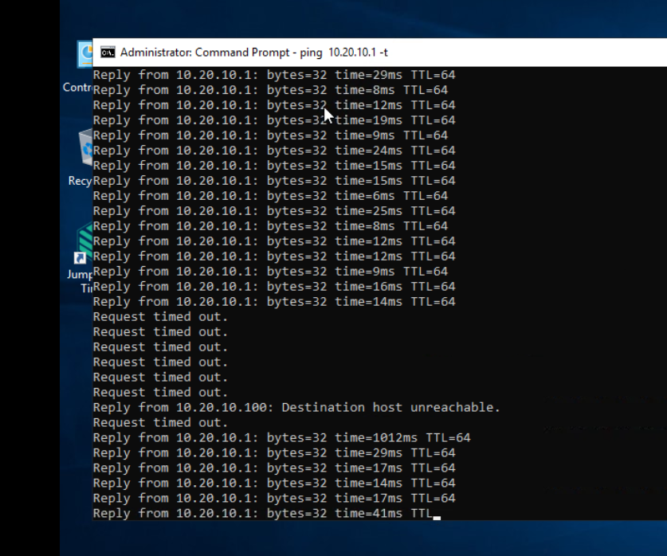

# Evidências selecionadas

Capturas fornecidas durante a execução do laboratório. Foram selecionadas telas de topologia e console pertinentes aos resultados, sem incorporar o backup integral ou o histórico completo de navegação.

| Arquivo | O que comprova |
|---|---|
| [Topologia corrigida](../assets/evidencias/topologia-corrigida.png) | Cabeamento dos cores, acessos e porta da VM |
| [DHCP CORP](../assets/evidencias/dhcp-corp.png) | Cliente `10.10.10.100/24`, gateway `10.10.10.1` |
| [DHCP GUEST](../assets/evidencias/dhcp-guest.png) | Cliente `10.20.10.100/24`, gateway `10.20.10.1` |
| [STP nominal CORP](../assets/evidencias/stp-corp-nominal.png) | Root CORE1, custo 4 e uplink alternativo bloqueado |
| [STP nominal GUEST](../assets/evidencias/stp-guest-nominal.png) | Root CORE1, custo 4 e uplink alternativo bloqueado |
| [STP GUEST durante falha](../assets/evidencias/stp-guest-falha.png) | Gi0/2 Root FWD e custo 8 |
| [Ping durante falha](../assets/evidencias/ping-falha-recuperacao.png) | Perdas e retorno das respostas do VIP GUEST |

## DHCP confirmado

### CORP

### GUEST

## Estado nominal

### CORP

### GUEST

## Falha e recuperação

O cliente voltou a responder pelo VIP depois da falha do uplink. Não há evidência posterior à otimização de link-type/PortFast; essas capturas representam o teste anterior aos ajustes propostos.
